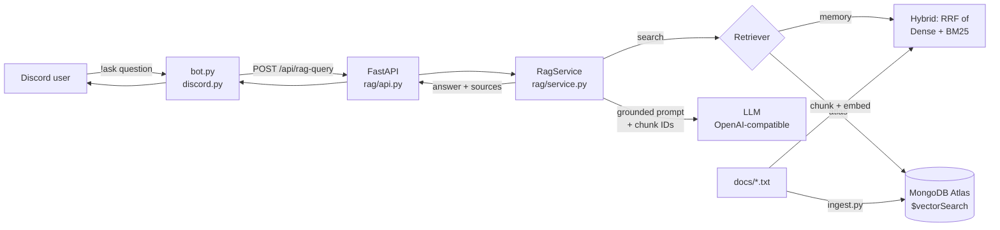

# Discord RAG FAQ Bot

[](https://github.com/Mfurlan03/discord-rag-backend/actions/workflows/ci.yml)


A retrieval-augmented generation (RAG) bot that answers questions in Discord from your own
documents, with source citations. It has a **FastAPI** backend, **pluggable retrieval**
(MongoDB Atlas Vector Search, or in-memory dense / BM25 / hybrid search), any
**OpenAI-compatible LLM** (DeepSeek via OpenRouter by default), and a **labeled retrieval
evaluation** that measures retrieval quality.

Example interaction (illustrative; the answer text depends on the LLM):

```text
!ask Who pays for cloud and API costs during the project?

Our company or the product managers in the same team will cover the cloud and API cost,
but not the computer device cost [intern_faq.txt_chunk_27].

Sources:
- intern_faq.txt (intern_faq.txt_chunk_27, score 0.03)
```

---

## Architecture



| Module | Responsibility |
|---|---|
| `rag/chunking.py` | Load docs; fixed-window and line-aware chunkers |
| `rag/embeddings.py` | Sentence-Transformers embedder, offline hashing embedder, TTL query cache |
| `rag/retrieval.py` | Dense (cosine), BM25, hybrid (Reciprocal Rank Fusion), Atlas `$vectorSearch` |
| `rag/service.py` | Orchestration: retrieve → filter → bounded context → LLM → cite; per-stage timings and metrics |
| `rag/api.py` | FastAPI app factory with injected dependencies (`/api/rag-query`, `/api/feedback`, `/healthz`, `/metrics`, `/config`) |
| `rag/formatting.py` | Discord reply formatting within the 2,000-char limit |
| `eval/` | Labeled question set and retrieval metrics |

### Design decisions

- **Hybrid retrieval with RRF.** FAQ questions mix exact terms ("Kajabi", "E-Verify",
  "OPT") with paraphrases. BM25 handles the first and embeddings handle the second.
  Reciprocal Rank Fusion merges the two rankings without calibrating their incompatible score scales.
- **Two backends, one interface.** `RETRIEVER_BACKEND=memory` indexes `./docs` at startup, so
  the bot runs locally with no database. `atlas` uses MongoDB Atlas Vector Search for production.
  Both implement the same `Retriever.search(query, k)` protocol.
- **Dependency injection.** `create_app(service, ...)` receives its retriever and LLM, so the
  31 tests run with a fake LLM and no network, model download or database.
- **Graceful degradation.** No hits → the LLM is never called (no hallucinated answers).
  No LLM key → sources are returned. Provider errors (quota, rate limit) → a clear message
  with a `status` field the client can branch on.
- **No secret leakage.** `/config` never echoes the API key or Mongo URI (covered by a test).

---

## Retrieval evaluation

`eval/questions.jsonl` holds 36 hand-labeled questions about the knowledge base. Each one is
paraphrased rather than copied, and labeled with its source document plus a short verbatim
**gold span**. A retrieved chunk counts as correct if it contains that span, so labels stay
valid when the chunking strategy changes.

```bash
python -m eval.run_eval                    # bm25, dense, hybrid × fixed, line-aware chunking
python -m eval.run_eval --modes bm25       # fully offline
```

Metrics: **Hit@k** (gold passage in the top k) and **MRR@10**. CI runs the full eval with
`all-MiniLM-L6-v2` on every push and publishes the table to the workflow summary.

**BM25 results** (offline, reproducible with the command above):

| Chunking | Chunks | Hit@1 | Hit@3 | Hit@5 | MRR@10 |
|---|---:|---:|---:|---:|---:|
| fixed (900 chars, 150 overlap) | 54 | 0.722 | 0.833 | 0.861 | 0.785 |
| line-aware (900 / 150) | 51 | 0.583 | 0.778 | 0.833 | 0.706 |

Dense and hybrid results with MiniLM: see the **retrieval-eval** job summary in
[Actions](https://github.com/Mfurlan03/discord-rag-backend/actions).

**What this showed:** line-aware chunking, which keeps bullets and Q/A lines intact, is
*worse* for BM25 on this corpus than plain fixed windows. So `CHUNK_STRATEGY` stays `fixed`
by default, and the change has to justify itself on the numbers.

---

## Quickstart (local, no database)

```bash
python -m venv .venv && source .venv/bin/activate   # Windows: .venv\Scripts\activate
pip install --extra-index-url https://download.pytorch.org/whl/cpu -r requirements.txt
cp .env.example .env          # add LLM_API_KEY (and DISCORD_BOT_TOKEN for the bot)

uvicorn app:app --reload      # http://127.0.0.1:8000/docs
python bot.py                 # second terminal
```

```bash
curl -X POST localhost:8000/api/rag-query -H "content-type: application/json" \
     -d '{"query": "Is the internship paid?"}'
```

### Docker

```bash
docker compose up --build                    # API only
docker compose --profile bot up --build      # API + Discord bot
```

The image uses CPU-only PyTorch, bakes in the embedding model so cold starts are fast, runs
as a non-root user and ships with a health check.

### MongoDB Atlas backend

1. Create an Atlas Vector Search index named `vector_index` on the `embedding` path
   (384 dimensions, cosine).
2. Set `RETRIEVER_BACKEND=atlas` and `MONGODB_URI` in `.env`.
3. `python ingest.py` (idempotent: replaces each document's chunks on re-run).

---

## Configuration

| Variable | Default | Description |
|---|---|---|
| `RETRIEVER_BACKEND` | `memory` | `memory` or `atlas` |
| `RETRIEVAL_MODE` | `hybrid` | `dense`, `bm25` or `hybrid` (memory backend) |
| `CHUNK_STRATEGY` | `fixed` | `fixed` or `lines` |
| `CHUNK_SIZE` / `CHUNK_OVERLAP` | `900` / `150` | Characters |
| `TOP_K` | `5` | Chunks passed to the LLM |
| `MIN_SCORE` | `0.25` | Cosine cut-off (dense / Atlas only) |
| `MAX_CONTEXT_CHARS` | `6000` | Hard prompt budget |
| `LLM_API_KEY` / `LLM_BASE_URL` / `LLM_MODEL` | — / OpenRouter / `deepseek/deepseek-chat` | Any OpenAI-compatible endpoint; `DEEPSEEK_*` also accepted |

## API

| Method | Path | Description |
|---|---|---|
| POST | `/api/rag-query` | `{query}` → `{answer, sources[], status, latencyMs, requestId}` |
| POST | `/api/feedback` | Store 👍/👎 feedback for later evaluation |
| GET | `/healthz` | Backend reachability, LLM configured |
| GET | `/metrics` | Request, status, hit and latency counters |
| GET | `/config` | Effective, secret-free configuration |

## Development

```bash
pip install -r requirements-dev.txt    # no torch needed
ruff check . && ruff format --check .
pytest -q
```

## Roadmap

- Cross-encoder re-ranking stage, measured with the same eval
- Answer-level evaluation (faithfulness / citation accuracy) using the stored feedback
- Streaming responses to Discord
